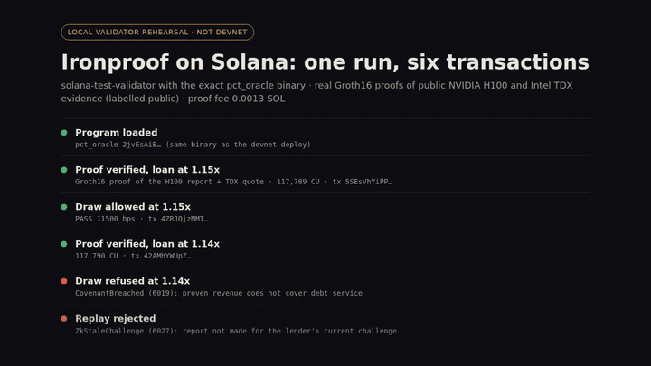
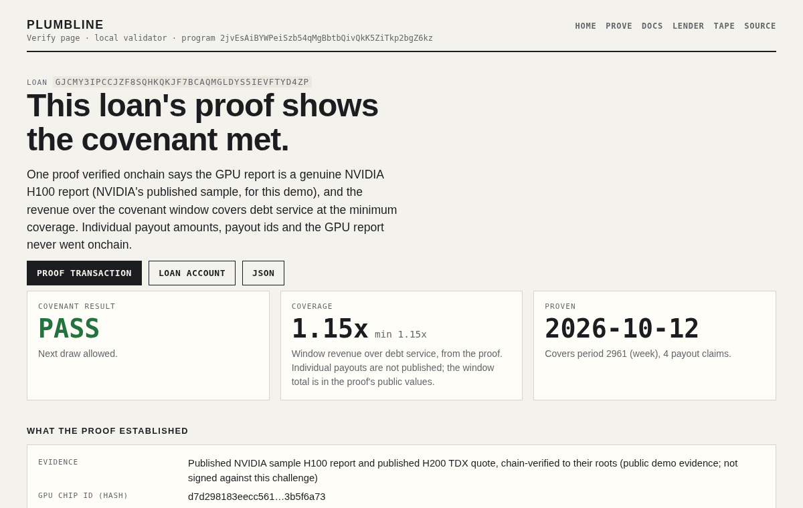
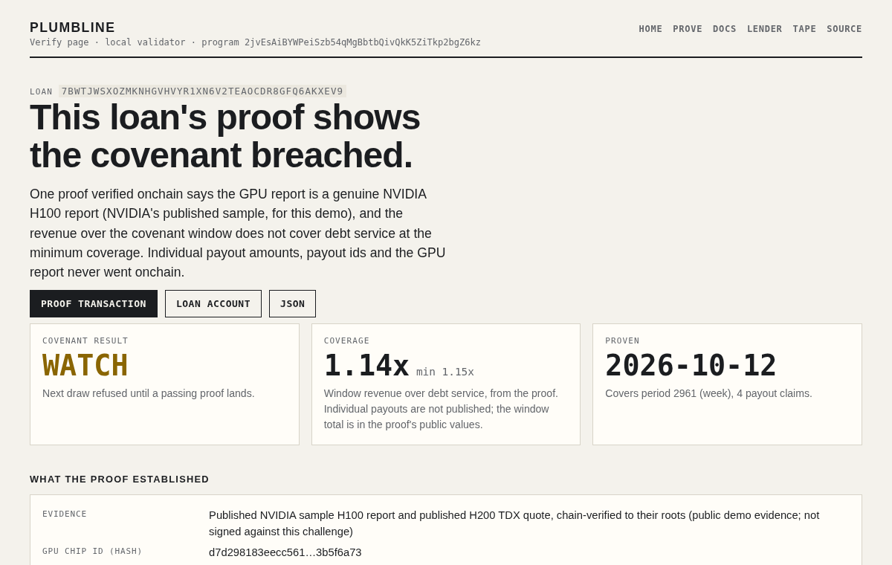
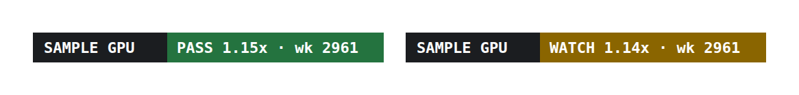

# Plumbline

**Plumbline gives lenders who finance GPU fleets a checkable proof behind each draw.** GPU-backed private credit (lenders
such as USD.AI, GAIB and Compute Labs) today relies on warranties, site audits and PDF revenue
statements to know that the collateral is real hardware and that it earns enough to service the
debt. With Plumbline an operator produces one zero-knowledge proof per period that says: the GPU that
answered the lender's challenge is a genuine NVIDIA H100 (its own attestation, chain-verified to NVIDIA's root), this is the Intel TDX
confidential VM it reports from (the lender can require the two to be bound; the demo cannot, see
below), and the fleet's revenue over the covenant window, proven from the
payment processor with zkTLS (Reclaim), covers debt service by at least the loan's minimum coverage
(a configurable minimum; 1.15x in the demo, which is USD.AI's own published quarterly floor). A Solana program verifies the 256-byte Groth16 proof,
records PASS or WATCH on the loan, and gates draws on it. Anyone can check a loan at
`/loan/<address>`, embed `/badge/<address>.svg`, or read `/api/loan/<address>`.

Naming: the product is **Plumbline**. `paid-compute-tape` (repo), `PCT` (`@pct/*` packages,
`pct_oracle`, `PCT_*` env vars) is the internal code prefix from the project's first form, an
H100 price tape, which still exists as a by-product (`/tape`).

Entry for the Colosseum Crypto World's Fair hackathon (submissions due 2026-10-12).

## For judges (60 seconds)



- **What ran (Solana devnet, Oct 12):** the exact `oracle/dist/pct_oracle.so`, as program [`2jvEsAiBYWPeiSzb54qMgBbtbQivQkK5ZiTkp2bgZ6kz`](https://explorer.solana.com/address/2jvEsAiBYWPeiSzb54qMgBbtbQivQkK5ZiTkp2bgZ6kz?cluster=devnet), deployed in [this transaction](https://explorer.solana.com/tx/3BbBX4diKE6MdinjzwDDynpHLne3bpErvFQoATY3JBPPXnHgvJLZ35vKP6RJviF6vB8d5UYqV85F6CBpMpkk1FN1?cluster=devnet). The 1.15x loan's proof verified ([proof](https://explorer.solana.com/tx/41ZoCoxTFb1MqUQKu5Qa1bRwEUch77nEUXmihPCCckvDjR52mhnAvgAQ4LqtnJZ7sjHjLFwg2Zb6yfat6RUJ7Nb7?cluster=devnet)) and its draw was approved ([draw](https://explorer.solana.com/tx/5DWV6UU7jTPem7HDUtrHrmLqeGvM3x7UzMe1XHALoXdT6ZTEoKGYS5BbbfKicrfJZLhuWbo4fpa16hUhhCyFs1er?cluster=devnet)). The 1.14x loan's proof verified ([proof](https://explorer.solana.com/tx/59nKZTGUKSDV7R57ZAf49vMCEqEPf2yjvhHy5Qd7XdPLJebJiaPkBn7pnVfWzBR4uXVJzC2r2h62mTJQQdSbHtmV?cluster=devnet)) and its draw was refused with `CovenantBreached` (6019) ([draw](https://explorer.solana.com/tx/5kV48qNZNwMfrVrxsq33qtj3QQSPtkRLqmZegw9QxoxoEDuW2birgnDJMaUnsN5U9cvN32tJZDcB7YdjRs7g1AYA?cluster=devnet)). Replaying the 1.15x proof was refused with `ZkStaleChallenge` (6027) ([replay](https://explorer.solana.com/tx/4W46GmRQ5YWZj6HsGe4jz5KKUvDDwxyeBXLSdo1eP4zf9NT25QGH5y783RZDHpXFPJYK19JQMKBYzYRUJzHnvFvq?cluster=devnet)). Each verify took about 119.7k CU. That binary is this branch's `oracle/dist/pct_oracle.so`, sha256 `89edffd1…5b8e`.
- **Local rehearsal, same binary:** on a local validator the proofs took 119,701 and 119,702 CU with the same three outcomes. Output: [`demo/local-validator-run.json`](demo/local-validator-run.json) and [`.log`](demo/local-validator-run.log); their explorer links point at `127.0.0.1:8899`, so they open only on the machine that ran the validator.
- **Run it yourself:** one command, `npm run zk:local`, against a local validator with the same binary, then `npm run web` to see the pages ([Quickstart](#quickstart), about 5 minutes, no keypair or SOL).
- **Check it without Solana:** `cd zk && cargo test` verifies NVIDIA's H100 certificate chain (P-384) and the TDX quote natively, and parses a raw H200 report without verifying its signature (23 tests, about 30 s once crates are cached); `npm install && npm test` runs the TypeScript suite.
- **Read first:** [What runs on sample data](#what-runs-on-sample-data). Every input in the demo is a published sample or a test key; the verifier, the program and the proofs are real.
- **Who it is for:** [First facility](docs/first-facility.md) maps USD.AI's public GPU loan book to what a weekly proof would add, including the 92% of it on Blackwell that Plumbline has not tested.
- **Code worth reading:** `zk/lib/src/gpu.rs` (NVIDIA chain), `oracle/programs/pct_oracle/src/risc0_groth16.rs` (Groth16 on alt_bn128), `oracle/programs/pct_oracle/src/instructions/zk.rs` (challenge, covenant, fee, draw gate).

| PASS loan, draw allowed | WATCH loan, draw refused |
| --- | --- |
|  |  |



## What is real today

| Piece | Evidence |
| --- | --- |
| RISC Zero guest that verifies an NVIDIA SPDM report to NVIDIA's root (P-384), a TDX v4 quote to Intel's root (P-256), and k-of-n Reclaim-format revenue claims, and computes the covenant | `zk/lib/src/{gpu,tdx,revenue}.rs`, guest `zk/risc0/methods/guest/src/main.rs`, see [`zk/README.md`](zk/README.md) |
| Real Groth16 proofs of that guest, committed | `zk/fixtures/covenant-strong*-groth16.json` (image id `0xbf16300e…bfe2`) |
| Groth16 verification inside the Anchor program, with challenge replay protection, terms/attestor/source pinning and a per-proof fee | `oracle/programs/pct_oracle/src/instructions/zk.rs`, `src/risc0_groth16.rs`, VK `src/risc0_vk.rs` (risc0-groth16 3.0.5) |
| Opt-in cross-lender GPU registry: a `Device` PDA per chip id from the proof journal, so one GPU backs one loan at a time (`DevicePledgedElsewhere`), with per-loan challenge nonce claims against proof replay (`NonceTaken`), released by that loan's lender or borrower or the config authority | `oracle/programs/pct_oracle/src/instructions/registry.rs`; LiteSVM tests `tests/registry.rs` ([`oracle/README.md`](oracle/README.md#device-registry)). Off by default; demo flows do not turn it on. Included in the prebuilt `oracle/dist/pct_oracle.so` |
| Web app reading straight from Solana: product site, lender view, verify page, badge, JSON API, lead form | `packages/web` (`npm run web`) |
| TypeScript suite (index math, prover, oracle client, relayer, web) and clean typecheck | `npm test`, `npm run typecheck` |

## What runs on sample data

Be clear about this before you judge the demo:

- **GPU evidence is NVIDIA's published sample H100 report**, not a GPU answering a lender's challenge.
  The host always uses it (`zk/risc0/host/src/main.rs`), and the devnet demo sets the lender's
  challenge to the nonce already inside it (`scripts/zk-devnet-demo.ts`). The host has no mode yet
  for an operator's own report, quote and claims.
- **The TDX quote is VoltageGPU's published H200 quote** and is not bound to that GPU report, so
  `vm_bound = 0` (`zk/lib/src/lib.rs`, test `fixture_vm_is_not_bound_to_the_sample_gpu`). The demo
  leaves `require_vm_bound` off.
- **TDX checks are structural only**: no TCB status, QE identity, CRL or validity-window checks
  (`zk/lib/src/tdx.rs`).
- **Revenue in the zk demo is synthetic**, signed by two deterministic test attestor keys that anyone
  can derive (`scripts/make-zk-fixtures.ts`). The price-oracle fixtures do the same
  (`scripts/make-oracle-fixtures.ts`). Reclaim runs a single attestor today, so the 2-of-n rule is
  exercised only with test keys.
- **Revenue privacy is partial.** Individual payments and payout amounts stay inside the proof, but
  the journal carries the total window revenue in plaintext (`zk/lib/src/lib.rs:61`) and it is sent
  as instruction data.
- **Pricing in the program is a flat `fee_lamports` per proof** (`zk.rs`), charged on every proof.
  There is no per-GPU fee and no free tier in code.
- **The demo fixtures expire.** They cover week 2961. The program accepts them only until
  **2026-10-15 00:00 UTC**; after that they must be regenerated (exact steps in
  [`zk/README.md`](zk/README.md#fixture-expiry-read-before-a-demo)).
- **The price tape** has no real paid-price proof yet, and the Hyperliquid relayer has not registered
  a testnet market (`packages/relayer/README.md`).

## Architecture

```
 operator side (offline, ~1.5-2 h per proof)                      Solana                         anyone
 ------------------------------------------                       ------                         ------
 NVIDIA H100 SPDM report + cert chain --+
 Intel TDX quote of the confidential VM -+--> RISC Zero guest --> Groth16 wrap --> pct_oracle      /loan/<addr>
 Reclaim zkTLS revenue claims (Razorpay,-+    (zk/risc0)          (256-byte seal)   prove_covenant  /badge/<addr>.svg
   Stripe), k-of-n attestor signatures   |    journal: hashes,                      -> ZkCovenant   /api/loan/<addr>
 loan terms, lender's GPU challenge -----+    coverage, PASS/WATCH                  -> draw_private (packages/web)

 Reclaim zkTLS claims (one at a time) -------------------------------------------> submit_revenue  /lender
                                                                                   submit_observation -> price books -> /tape -> Hyperliquid HIP-3 relayer
```

1. **Guest** (`zk/risc0/methods/guest`, logic in `zk/lib`): verifies the GPU report, the TDX quote
   and every revenue claim, then commits a 262-byte journal (layout in `zk/README.md`).
2. **Groth16**: the STARK receipt is wrapped with RISC Zero's Groth16 prover (Docker) so it fits a
   Solana transaction.
3. **Program** `pct_oracle` (Anchor, `oracle/`): `issue_gpu_challenge` (lender), `prove_covenant`
   (Groth16 verify, journal checks against the loan's terms, attestor set, source and challenge,
   fee), `draw_private` (allowed only on a recent PASS). The same program also verifies individual
   Reclaim claims (`submit_revenue`, `submit_observation`) for the transparent lending flow and the
   price tape.
4. **zkTLS revenue** (`packages/prover`, `packages/oracle`): Reclaim zkFetch proves a payment or
   payout straight from Razorpay or Stripe, revealing only amount, currency, time and payment id.
   Trust today is Reclaim's attestor set.
5. **Price tape** (`packages/core`, onchain books): realized $/GPU-hour from paid invoices and
   revenue proofs, MAD outlier rejection, 25% per-provider cap, weighted median.
   `packages/relayer` can push it to a Hyperliquid HIP-3 market.

## Read a covenant from your own program or client

Each loan's latest result is one account: the `ZkCovenant` PDA at seeds `[b"zk_covenant", loan]`
under program `2jvEsAiBYWPeiSzb54qMgBbtbQivQkK5ZiTkp2bgZ6kz`
(`oracle/programs/pct_oracle/src/instructions/zk.rs`). Its fields include `status` (1 PASS, 2 WATCH),
`coverage_bps`, `as_of_period`, `claims`, `chip_id` (sha256 of the GPU's chip id), `measurements`,
`vm_measurement`, `vm_bound` and `proven_at`. A vault, a curator's dashboard or another program can
read it directly, with no API key and no oracle call. Without Solana tooling, use
`GET /api/loan/<address>`.

## Quickstart

```bash
npm install
npm test                 # vitest, all TypeScript packages
npm run typecheck
```

**Local validator end to end** (Linux, macOS or WSL; about 5 minutes from a fresh clone). Needs the
Agave 3.1 CLI: `sh -c "$(curl -sSfL https://release.anza.xyz/v3.1.14/install)"`, or, if that host is
unreachable, unpack
[the same release from GitHub](https://github.com/anza-xyz/agave/releases/download/v3.1.14/solana-release-x86_64-unknown-linux-gnu.tar.bz2)
and put its `bin/` on your `PATH`. No keypair or SOL needed: the scripts airdrop to a fixed local authority.

```bash
# terminal 1: the exact devnet binary, at its devnet program id
solana-test-validator --reset --limit-ledger-size 50000000 \
  --bpf-program 2jvEsAiBYWPeiSzb54qMgBbtbQivQkK5ZiTkp2bgZ6kz oracle/dist/pct_oracle.so

# terminal 2, from the repo root
npm run zk:local         # the product: two Groth16 proofs verified (~120k CU each), 1.15x draw approved,
                         # 1.14x draw refused (CovenantBreached), replayed proof refused (ZkStaleChallenge)
npm run lending:e2e      # optional, the earlier transparent flow: per-claim revenue proofs gate draws
npm run oracle:e2e       # optional, the H100 price tape: fixture claims, replay refused, index $2.49
SOLANA_RPC_URL=http://127.0.0.1:8899 npm run web   # http://localhost:8787, then open /lender
```

`zk:local` writes `zk-devnet-demo.json` with every loan address and transaction. `/lender` lists
every loan on the program; each has a verify page (`/loan/<address>`), a badge and a JSON endpoint.
The three scripts run in any order. The committed proofs are accepted until 2026-10-15 00:00 UTC
(see [What runs on sample data](#what-runs-on-sample-data)).

Rust tests: `cargo test` in `oracle/` (LiteSVM, needs `cargo build-sbf` first) and in `zk/`.
Proving: see [`zk/README.md`](zk/README.md).

**Real revenue proofs** need Reclaim app keys (`cp .env.example .env`, keys from
https://dev.reclaimprotocol.org/) and a Razorpay or Stripe test account; see `oracle/README.md`.

## Devnet deployment

> **Deployed on 2026-10-12** from this branch's `oracle/dist/pct_oracle.so` (sha256 `89edffd1…5b8e`).

| Item | Value |
| --- | --- |
| Target program id | `2jvEsAiBYWPeiSzb54qMgBbtbQivQkK5ZiTkp2bgZ6kz` (fixed by `declare_id!`) |
| Prebuilt binary | `oracle/dist/pct_oracle.so`, sha256 `89edffd1a1e9e3cd84e9a3c079a30c02c934e0a3bde3458d2d6c75d1aa4f5b8e`, reproducible from source with Agave 3.1.14 and platform-tools v1.52 |
| Deploy and demo script | `scripts/devnet-go.ps1` (deploys the checked-out branch's binary and waits for the SOL its size needs, 9.12 for this one), then `npm run zk:devnet` |
| Program explorer link | [2jvEsAiBYWPeiSzb54qMgBbtbQivQkK5ZiTkp2bgZ6kz](https://explorer.solana.com/address/2jvEsAiBYWPeiSzb54qMgBbtbQivQkK5ZiTkp2bgZ6kz?cluster=devnet) (ProgramData `DVRJ7wEJf3MZyTb1sGEoYQxRwFs2J686jkWjBRcsEagu`, 640,496 bytes; [deploy tx](https://explorer.solana.com/tx/3BbBX4diKE6MdinjzwDDynpHLne3bpErvFQoATY3JBPPXnHgvJLZ35vKP6RJviF6vB8d5UYqV85F6CBpMpkk1FN1?cluster=devnet)) |
| PASS loan (1.15x, draw approved) | [proof](https://explorer.solana.com/tx/41ZoCoxTFb1MqUQKu5Qa1bRwEUch77nEUXmihPCCckvDjR52mhnAvgAQ4LqtnJZ7sjHjLFwg2Zb6yfat6RUJ7Nb7?cluster=devnet), [draw](https://explorer.solana.com/tx/5DWV6UU7jTPem7HDUtrHrmLqeGvM3x7UzMe1XHALoXdT6ZTEoKGYS5BbbfKicrfJZLhuWbo4fpa16hUhhCyFs1er?cluster=devnet) |
| WATCH loan (1.14x, draw refused, 6019) | [proof](https://explorer.solana.com/tx/59nKZTGUKSDV7R57ZAf49vMCEqEPf2yjvhHy5Qd7XdPLJebJiaPkBn7pnVfWzBR4uXVJzC2r2h62mTJQQdSbHtmV?cluster=devnet), [draw](https://explorer.solana.com/tx/5kV48qNZNwMfrVrxsq33qtj3QQSPtkRLqmZegw9QxoxoEDuW2birgnDJMaUnsN5U9cvN32tJZDcB7YdjRs7g1AYA?cluster=devnet) |
| Replay of the PASS proof (refused, 6027) | [replay](https://explorer.solana.com/tx/4W46GmRQ5YWZj6HsGe4jz5KKUvDDwxyeBXLSdo1eP4zf9NT25QGH5y783RZDHpXFPJYK19JQMKBYzYRUJzHnvFvq?cluster=devnet) |
| Hosted site | _pending_ |
| Local-validator rehearsal, same binary | see [`demo/`](demo/) |

The committed proofs stop being accepted at 2026-10-15 00:00 UTC; a later deploy needs
regenerated proofs first (`zk/README.md`).

## Repository layout

| Path | What it is |
| --- | --- |
| `zk/` | RISC Zero guest, shared verification library, host, fixtures and committed Groth16 proofs. [`zk/README.md`](zk/README.md) |
| `oracle/` | Anchor program `pct_oracle` (oracle, lending, Groth16 verifier), LiteSVM tests, prebuilt `dist/pct_oracle.so`. [`oracle/README.md`](oracle/README.md) |
| `packages/web` | Site and dashboard read straight from Solana: product page (`/`), prove (`/prove`), docs (`/docs`), lender view (`/lender`), price tape (`/tape`), verify page (`/loan/<address>`), badge (`/badge/<address>.svg`), JSON (`/api/loan/<address>`, `/api/loans`, `/api/state`), lead form (`POST /api/lead`). `PCT_EVIDENCE` defaults to `public` (proofs use the published sample evidence); set `own` only for proofs made against the loan's own challenge. |
| `packages/oracle` | TS client for the program: price proofs, loans, revenue proofs, zk instructions, draws; CLIs `oracle:*`, `loan:*`. |
| `packages/prover` | zkFetch source specs and request builder (secrets stay private, only the captured spans are revealed, account ids OPRF-hashed), proof checks, CLIs. |
| `packages/core` | Price index math, the reference for the onchain books. |
| `packages/relayer` | Pushes the onchain index to a Hyperliquid HIP-3 market (`hl:deploy`, `hl:relay`). |
| `sources/` | One JSON spec per provable price source; `example-invoice.json` shows the format. |
| `scripts/` | Fixture generators (`make-*-fixtures.ts`), local e2e runs, the devnet demo (`zk-devnet-demo.ts`), `devnet-go.ps1`. |
| `integrations/swarm-sn124/` | Pilot patch for Swarm's (Bittensor SN124) validator, against upstream commit `38b36a2`: with `SWARM_IRONPROOF=1` the seed key is sealed to an attested TDX enclave that scores. Tested against a mock backend, not live. [`RUN.md`](integrations/swarm-sn124/RUN.md) |
| `proofs/` | Generated proofs (git-ignored). |

## Hosting the site

The `Dockerfile` runs `packages/web` (site, verify pages, badges, lead form) on `$PORT`. On Railway, from the repo root:

```bash
npm i -g @railway/cli
railway login
railway init --name plumbline
railway up --detach                  # first deploy creates the service
railway service                      # link it (pick the service just created)
railway variables --set "SOLANA_RPC_URL=https://api.devnet.solana.com" --set "PCT_PROGRAM_ID=2jvEsAiBYWPeiSzb54qMgBbtbQivQkK5ZiTkp2bgZ6kz" --set "PCT_EVIDENCE=public" --set "LEADS_FILE=/data/leads.jsonl"
railway volume add --mount-path /data   # keeps leads.jsonl across deploys
railway domain                       # prints the public URL
railway up --detach                  # redeploy with the variables
```

`.railwayignore` and `.dockerignore` upload only the web workspace: no keys, `.env`, proofs or logs.
Loan reads are cached in memory for `PCT_CACHE_TTL_MS` (default 30000) so page views do not fan
out to the RPC on every request; server errors are logged and the client gets a generic message.

## Trust model and limitations

- **zkTLS.** Reclaim's verifier checks attestor signatures over the TLS transcript claim, so revenue
  and price proofs trust Reclaim's attestor set (one attestor today). Revenue sources must be pinned
  to a third-party system of record (Razorpay, Stripe, a marketplace payout API), never the
  operator's own server.
- **Hardware.** Sample GPU report, unbound TDX quote, no TCB/QE/CRL collateral checks (above).
- **One GPU per proof, not ownership.** A proof shows that one specific attested GPU answered a fresh
  challenge. It does not show that the operator owns that GPU (a rented one answers just as well), nor
  anything about the rest of the fleet: `fleet_gpus` in the loan terms is the lender's number, not a
  proven one. Fleet coverage needs every GPU proven once against a lender-held chip list and a sample
  re-proven each week; that is planned, not built.
- **Cross-lender registry is off by default.** Until the authority turns the device registry on, one
  GPU can back loans from more than one lender: each lender issues its own challenge and the operator
  answers each.
- **Privacy.** The window revenue total is public in the journal.
- **Security.** The guest, the hand-written Groth16 verifier and the program are unaudited. The
  lending vault is a toy SOL vault with debt terms in the loan currency.
- **Price tape.** A live index needs three or more independent providers; no real paid-price proof
  has been published. The original Day 1 gate (one real invoice proof that reveals only price,
  hours and a nullifier) is still open: `npm run prove:list`, `npm run probe`,
  `npm run prove:invoice -- sources/<provider>.json`, `npm run verify`.

## Roadmap

1. Link the devnet run from the hosted site.
2. Fixtures that track the current week (`AS_OF` from the clock and a one-command refresh).
3. Operator-input host mode: own GPU report, TDX quote bound to it (`vm_bound = 1`), real Reclaim claims.
4. TDX collateral checks (TCB status, QE identity, CRLs) and NVIDIA RIM checks in the guest.
5. Commit only the PASS bit or a salted revenue hash instead of the plaintext total.
6. Loan-based pricing in the program (a facility fee plus 5 to 15 basis points a year on the loan), matching the site.
7. Second independent attestor (or Reclaim TEE mode), then an audit before mainnet.
8. Hardening path for the tape: k-of-n independent provers, then aggregating attestations and the
   median into one RISC Zero proof verified on Solana with the same Groth16 verifier.

## Also in this repository (earlier form of the project)

The project started as a paid H100 price tape and a revenue-backed lending flow. That code still
runs and is tested:

| Piece | Evidence |
| --- | --- |
| Onchain Reclaim claim checking: secp256k1 signer recovery, canonical context parsing, nullifier PDAs, covenant-window math, a toy lending vault | `oracle/programs/pct_oracle/src/{reclaim.rs,instructions/lending.rs}`; LiteSVM tests `tests/{flow,lending,zk}.rs` |
| Price oracle and lending flows driving a local validator end to end | `npm run oracle:e2e`, `npm run lending:e2e` ([`oracle/README.md`](oracle/README.md)) |
| zkTLS revenue proofs from a real Razorpay or Stripe test account | `npm run prove:revenue`, `npm run loan:*` (walkthrough in `oracle/README.md`). No proof artifact is committed |

## Credits

Demo evidence comes from public sources and is unchanged:
- `zk/fixtures/h100-sample-report.hex` and `h100-sample-certchain.pem`: NVIDIA's sample H100 attestation
  report and certificate chain from [nvtrust](https://github.com/NVIDIA/nvtrust) (the local GPU verifier's test data).
- `zk/fixtures/tdx/`: VoltageGPU's published H200 Confidential VM attestation (Intel TDX quote and GPU
  report), captured 4 September 2026 ([article](https://voltagegpu.com/blog/two-proofs-tdx-nvidia-h200-attestation-tenant)); provenance in `zk/fixtures/tdx/README.txt`.

## License

MIT, see [LICENSE](LICENSE). The H100 attestation verifier, the Groth16 verifier program and the guest are open source and reusable.
